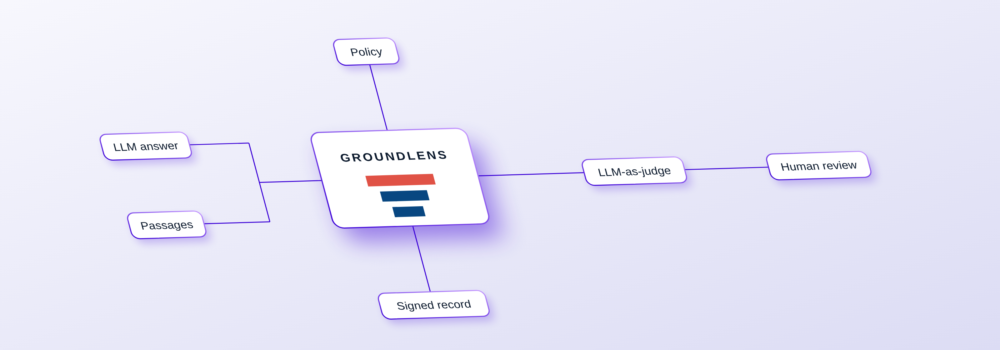

 

# Guardrails for LLM answers

 

GroundLens checks an LLM answer

against its sources without a model,

decides PASS, REVIEW or FAIL under 

your policy, and keeps a signed record.

## Why Groundlens

LLM answers now carry figures that organisations act on: amounts, rates,
dates, limits. The tools around them grew in three directions: evaluation
before release, observability in production, and filters on what goes in and
out. None of them answers the question asked when a decision is challenged:
was this answer checked, how, under which rule, and can you prove it?

GroundLens answers it for every answer. The checks are exact, so the same
answer gets the same result on any machine. The policy that decides is a file
you own. The record of each decision is signed, chained to the one before,
and checkable by anyone without our software.

 

## How it works

- **A check produces evidence, not truth.** Your policy decides what it means.
- **Exact first.** No model where arithmetic will do. A model, if you add one, can escalate an answer, never pass it.
- **Nothing that failed can pass.** A check that could not run, or a record that could not be stored, is never a PASS.
- **Runs where you run.** In your process, with no network, no account and no access to your models or prompts.
- **Open, so it can be trusted.** A record is only evidence if anyone can inspect the code that writes and verifies it.

 

## Project content

| | |
|---|---|
| **[groundlens](https://github.com/groundlens-dev/groundlens)** | The package and the engine. Start here: `pip install groundlens` |
| **[Documentation](https://groundlens.readthedocs.io)** | Guides, policies, integrations and the full reference |
| **[groundlens.dev](https://groundlens.dev)** | What it does, what it catches, and how it compares with other tools |
| **MCP registry** | `io.github.groundlens-dev/groundlens`, for agents that check their own answers |

 

## Open source, and beyond

The engine, the checks, the policies, the connectors, the command line and
the MCP server are Apache-2.0, and will stay so. For teams that need more:
measurement on your own data, evidence packages for procurement and
conformity files, maintained policies and regulatory mappings, and private
deployment. Write to javier@groundlens.dev.

 

Copyright GroundLens 2026

